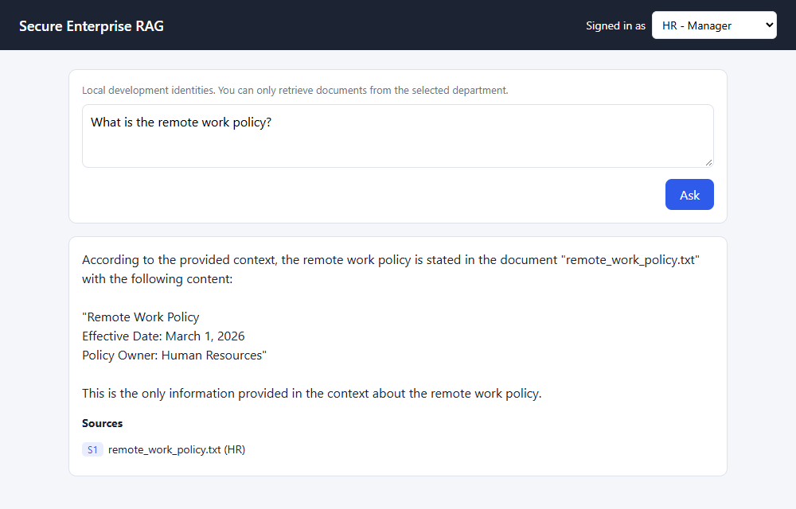
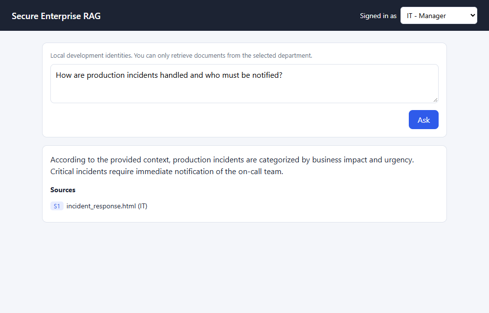

# Secure-Enterprise-RAG

RAG over enterprise documents with department-level access control. A user only
retrieves documents from their own department (HR, IT, Finance, Legal), and within
it only those whose allowed roles/users/groups match. The filter is enforced in the
OpenSearch query itself, and fails closed.

Pipeline: parse (PDF/HTML/TXT) -> chunk -> embed (MiniLM) -> OpenSearch ->
hybrid search (vector + BM25, RRF) -> cross-encoder rerank -> context + citations -> Ollama.

## Run locally

1. Install dependencies

       python -m venv .venv
       .venv\Scripts\activate
       pip install -r requirements.txt

2. Start OpenSearch (security disabled, local development only)

       docker compose up -d

3. Create the index and ingest `data/documents`

       set PYTHONPATH=.
       python scripts/create_index.py
       python scripts/index_documents.py

4. Install [Ollama](https://ollama.com) and pull a model

       ollama pull llama3.2

5. Start the API and open the UI at http://localhost:8000

       uvicorn app.main:app --port 8000

The UI lets you pick a local-dev identity, ask questions, and see the answer with its
cited sources. Interactive API docs are at http://localhost:8000/docs.

## Query

    curl -X POST http://localhost:8000/query ^
      -H "Authorization: Bearer dev-hr-associate" ^
      -H "Content-Type: application/json" ^
      -d "{\"query\": \"What is the remote work policy?\"}"

## Local-dev identities

Tokens are `dev-<department>-<level>`: departments `hr`, `it`, `finance`, `legal`;
levels `associate` (role `employee`) and `manager` (roles `employee`, `manager`).
The server maps the token to the user, so callers cannot choose their own
departments or roles. **This is for local development only**; replace
`app/auth.py` with real token validation (for example OIDC/JWT) before any real use.

## Access-control demo

[Watch the demo video](docs/demo.webm) (about 50 seconds). It shows four scenarios using the
UI, each captioned:

| Identity | Question | Result |
|---|---|---|
| HR Manager | "What is the remote work policy?" | Answered from HR documents |
| HR Manager | "How are production incidents handled and who must be notified?" (IT topic) | **Refused**, no sources |
| HR Manager | "What are the vendor payment approval controls?" (Finance topic) | **Refused**, no sources |
| IT Manager | "How are production incidents handled and who must be notified?" | Answered, cites an IT document |

### Screenshots

**Allowed: HR Manager asks an HR question**

**Rejected: HR Manager asks about IT**

**Rejected: HR Manager asks about Finance**

**Allowed: IT Manager asks the same IT question**

**Rejected: Finance Associate asks about HR**

A refused request never reaches the LLM: retrieval is filtered to the user's department
inside OpenSearch, and if nothing relevant and authorized remains, the API returns a
fixed refusal. The manager role does not grant access across departments.

To regenerate the video and screenshots (the API must be running and documents indexed):

    pip install playwright
    playwright install ffmpeg
    python scripts/record_demo.py
    python scripts/capture_screenshots.py

It drives the locally installed Microsoft Edge browser.

## Configuration

Environment variables (or `.env`): `RAG_OLLAMA_URL`, `RAG_OLLAMA_MODEL`,
`RAG_OLLAMA_TIMEOUT_SECONDS`, `RAG_CANDIDATE_K`, `RAG_TOP_K`, `RAG_MIN_RERANK_SCORE`
(chunks scoring below this are treated as irrelevant; default `-2.0`, tuned for the
sample documents).

## Tests

    pytest tests